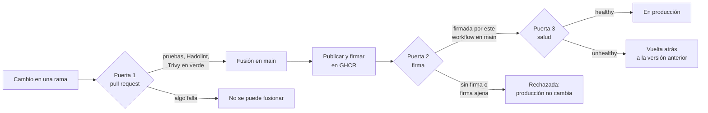

# PPS · L3 · Ejemplo resuelto de la P3.3: entrega y despliegue seguros

Este repositorio es el **ejemplo resuelto de la práctica P3.3** del laboratorio 3 (*Despliegue seguro con
contenedores Docker*) del módulo **Puesta en Producción Segura** (Curso de Especialización en
Ciberseguridad, 2026/27). Recorre, de principio a fin, el camino que lleva un cambio de código desde el
ordenador de quien lo escribe hasta producción, con un control automático en cada paso.

Se usa en clase para enseñar cómo debe quedar cada paso de la **sección 10 del laboratorio**. No sustituye a
la práctica: cada estudiante construye el suyo en `PPS-L3-entrega-<usuario-github>`.

> **Diferencia con vuestro repositorio.** La guía pide exactamente **nueve ficheros**. Este repositorio tiene
> uno más, este `README.md`, que solo sirve para explicar el ejemplo. No forma parte de la imagen: el
> `.dockerignore` excluye los ficheros `*.md`.

## Índice

1. [Qué problema resuelve](#1-qué-problema-resuelve)
2. [Las tres puertas](#2-las-tres-puertas)
3. [Qué hay en el repositorio](#3-qué-hay-en-el-repositorio)
4. [La aplicación y su imagen](#4-la-aplicación-y-su-imagen)
5. [El *pipeline*: `.github/workflows/entrega.yml`](#5-el-pipeline-githubworkflowsentregayml)
6. [La firma sin claves](#6-la-firma-sin-claves)
7. [La regla `proteger-main`](#7-la-regla-proteger-main)
8. [La historia del repositorio, paso a paso](#8-la-historia-del-repositorio-paso-a-paso)
9. [Producción: lo que no está en este repositorio](#9-producción-lo-que-no-está-en-este-repositorio)
10. [Cómo comprobarlo por tu cuenta](#10-cómo-comprobarlo-por-tu-cuenta)
11. [Qué no detecta](#11-qué-no-detecta)
12. [DevSecOps: lo que ya hace y lo que falta](#12-devsecops-lo-que-ya-hace-y-lo-que-falta)
13. [Relación con el módulo](#13-relación-con-el-módulo)

---

## 1. Qué problema resuelve

En las secciones 2 a 9 del laboratorio las imágenes se construyen, se analizan y se despliegan **a mano**.
Cada paso depende de que alguien se acuerde de hacerlo y lo haga bien: pasar las pruebas, analizar la imagen,
no desplegar una versión que no arranca, no ejecutar una imagen que no se sabe de dónde viene.

En un equipo real, eso falla. Las causas habituales son siempre las mismas:

- Un cambio llega a producción **sin que nadie lo haya revisado** ni probado.
- Una imagen base **vieja o vulnerable** entra sin que nadie lo note.
- Alguien con acceso al registro **sube una imagen manipulada** con la etiqueta de una buena.
- Una versión que pasa las pruebas **no arranca bien** en producción y el servicio se cae.

La respuesta de este repositorio es automatizar cada control y hacer que **nadie pueda saltárselo**, ni
siquiera quien administra el repositorio. Es la idea central de DevSecOps: la seguridad no es una revisión al
final, sino una serie de comprobaciones dentro del propio camino de entrega.

## 2. Las tres puertas

El camino tiene tres **puertas**. Cada una detiene un tipo distinto de problema:



| Puerta | Dónde está | Qué detiene |
| ------ | ---------- | ----------- |
| 1 · *Pull request* | GitHub: el *workflow* y la regla `proteger-main` | Código que no pasa las pruebas, un Dockerfile mal escrito, una imagen con vulnerabilidades críticas, un `push` directo a `main` |
| 2 · Firma | Producción: `desplegar.sh` con `cosign verify` | Cualquier imagen que no haya salido de este *workflow* en `main`, aunque esté en el mismo registro y con una etiqueta válida |
| 3 · Salud | Producción: `desplegar.sh` y el `HEALTHCHECK` de la imagen | Una versión firmada y correcta según las pruebas que, sin embargo, no funciona al arrancar |

Ninguna puerta basta sola. Es el mismo principio de **defensa en profundidad** de la sección 8: si una falla,
la siguiente frena el problema.

## 3. Qué hay en el repositorio

| Fichero | Para qué sirve |
| ------- | -------------- |
| `app.js` | La aplicación: una API mínima con Express y dos rutas, `/` y `/salud` |
| `servidor.js` | El arranque de la aplicación, separado para poder probar `app.js` sin abrir un puerto |
| `test/app.test.js` | Las pruebas automáticas, con el ejecutor de pruebas de Node (`node --test`) |
| `package.json` y `package-lock.json` | Las dependencias y sus versiones exactas: `npm ci` instala siempre lo mismo |
| `Dockerfile` | La imagen de producción: multietapa, sin *root* y con `HEALTHCHECK` |
| `.dockerignore` | Lo que **no** entra en la imagen: `.git/`, `.github/`, las pruebas, `.env`, `node_modules/` |
| `.gitignore` | Lo que **no** entra en el repositorio: `node_modules/`, `.env`, el SBOM generado |
| `.github/workflows/entrega.yml` | El *pipeline*: comprueba, publica y firma |

Todo lo demás (capturas, respuestas, el registro de despliegues, la configuración de producción) va en el
repositorio de entrega, que es **privado**. Este repositorio es público y lo será para siempre en lo que
respecta a sus firmas: Rekor, el registro de transparencia de Sigstore, no borra nada. Por eso solo contiene
lo imprescindible y ningún dato personal: todos los commits van firmados con una dirección `no-reply`.

## 4. La aplicación y su imagen

La aplicación es deliberadamente pequeña: lo que interesa es el camino, no el código.

- `GET /` responde con la versión desplegada, que lee de `package.json`. Así se ve a simple vista qué versión
  está en producción.
- `GET /salud` responde `{"estado":"ok"}` con un código 200. Es la ruta que consulta el `HEALTHCHECK`.

El `Dockerfile` aplica lo visto en las secciones 6 y 8:

| Decisión | Por qué |
| -------- | ------- |
| Dos etapas (`dependencias` y la final) | La imagen final solo lleva las dependencias de producción (`npm ci --omit=dev`): menos paquetes, menos vulnerabilidades |
| `FROM node:24-alpine`, por etiqueta | Cada construcción recoge los parches de seguridad de Node 24. Lo que garantiza que la imagen es la buena no es la etiqueta, sino el análisis y la firma del *pipeline* (sección 8, «¿Etiqueta o *digest*?») |
| `USER 1000:1000` | La aplicación no se ejecuta como *root*. Se indica por número para que cualquier herramienta lo entienda |
| `HEALTHCHECK` contra `/salud` | Docker marca el contenedor como *healthy* o *unhealthy*. Es la base de la puerta 3 |
| `.dockerignore` | Ni `.git/` ni el *workflow* ni las pruebas acaban dentro de la imagen |

## 5. El *pipeline*: `.github/workflows/entrega.yml`

El *workflow* se ejecuta en tres situaciones:

- En cada **pull request** hacia `main`: solo comprueba.
- En cada **push a `main`**, es decir, al fusionar: comprueba, publica y firma.
- **Cada lunes** (`schedule:`): vuelve a comprobar `main` aunque nadie haya cambiado nada, porque la imagen base
  y la base de datos de vulnerabilidades sí cambian. Si aparece una crítica nueva, la ejecución falla y GitHub
  avisa por correo.

Tiene dos *jobs* con permisos distintos.

### *Job* `comprobar`

Es el *check* que exige la regla `proteger-main`. Solo puede **leer** el código.

1. **Descargar el código** con `actions/checkout`, sin dejar el token guardado (`persist-credentials: false`).
2. **Instalar Node.js 24.**
3. **Pruebas**: `npm ci` y `npm test`. Si una prueba falla, todo se detiene.
4. **Hadolint**: revisa el `Dockerfile` contra las buenas prácticas.
5. **Construir la imagen.**
6. **Trivy**: analiza la imagen y **falla si encuentra alguna vulnerabilidad crítica**.
7. **Resumen**: escribe en la página de la ejecución una tabla con las vulnerabilidades altas y críticas, para
   que el equipo las vea y decida, aunque no bloqueen.
8. **SBOM**: genera la lista de componentes de la imagen en formato CycloneDX y la guarda como artefacto.

**¿Por qué solo bloquean las críticas?** Las imágenes base casi siempre tienen alguna vulnerabilidad alta,
muchas en herramientas que la aplicación no usa. Si el *pipeline* se detuviera con las altas, no se podría
desplegar nada y el equipo acabaría desactivando el control. El criterio habitual es **bloquear lo crítico y
mostrar lo alto**. Es una decisión de riesgo, y por eso queda escrita en el propio *workflow*.

### *Job* `publicar y firmar`

Solo se ejecuta con un `push` a `main` y solo si `comprobar` ha pasado. Es el único que puede escribir:

| Permiso | Para qué |
| ------- | -------- |
| `contents: read` | Leer el código |
| `packages: write` | Subir la imagen a GitHub Container Registry (GHCR) |
| `id-token: write` | Pedir a GitHub un certificado de identidad para firmar sin claves |

1. **Iniciar sesión en GHCR** con el token temporal del propio *workflow*, que caduca al terminar el *job*.
2. **Construir y analizar otra vez** la imagen que se va a publicar, para firmar exactamente lo analizado.
3. **Publicar** la imagen con el commit como etiqueta, y anotar su ***digest*** en el resumen.
4. **Firmar** la imagen por su *digest* con cosign, sin claves.
5. **Adjuntar el SBOM firmado** (`cosign attest`): cualquiera puede comprobar qué lleva la imagen y que esa
   lista no se ha alterado.

### Decisiones de seguridad del *workflow*

| Decisión | Qué evita |
| -------- | --------- |
| Dos *jobs* con permisos distintos | Que el código de un *pull request* sin revisar se ejecute con permiso para publicar o firmar |
| Cada *action* fijada por **SHA**, con la versión en un comentario | Que alguien mueva una etiqueta (`v4`) a código malicioso. Es lo que ocurrió el 19 de marzo de 2026 con `aquasecurity/trivy-action` (Paso 3 de la sección 10) |
| Hadolint y Trivy fijados por **digest** | Lo mismo, para las herramientas que se ejecutan como contenedor |
| `runs-on: ubuntu-24.04` y no `ubuntu-latest` | Que el sistema del *runner* cambie de versión sin avisar |
| `timeout-minutes: 15` | Que un paso colgado gaste horas de ejecución |
| Datos externos por `env:`, nunca `${{ … }}` dentro de `run:` | La inyección de órdenes a través del título de un *pull request* o el nombre de una rama |
| `pull_request` y no `pull_request_target` | Que el código de un *pull request* se ejecute con los secretos del repositorio |
| El *socket* de Docker montado en Trivy | No lo evita: es un riesgo **aceptado**. Trivy lo necesita para leer la imagen recién construida, el *runner* se destruye al terminar y la imagen de Trivy está fijada por *digest*. En un *runner* propio y permanente no sería aceptable |

## 6. La firma sin claves

La firma con clave de la sección 8 tiene un problema: **la clave privada hay que guardarla en algún sitio**, y
quien la robe puede firmar lo que quiera. La firma sin claves (*keyless*) de Sigstore elimina esa clave:

1. GitHub entrega al *job* un **token de identidad** (OIDC) que dice, firmado por GitHub, «soy el *workflow*
   `entrega.yml` del repositorio `politecnicoDAW-2026/PPS-L3-entrega-profesor`, ejecutándose en
   `refs/heads/main`».
2. cosign canjea ese token en **Fulcio**, la autoridad de Sigstore, por un **certificado** con esa identidad,
   válido solo diez minutos.
3. Con ese certificado firma el *digest* de la imagen, y la firma queda anotada en **Rekor**, el registro
   público de transparencia.

Al verificar no se pregunta «¿tengo la clave pública?», sino **«¿quién firmó esto?»**:

```bash
cosign verify \
  --certificate-identity "https://github.com/politecnicoDAW-2026/PPS-L3-entrega-profesor/.github/workflows/entrega.yml@refs/heads/main" \
  --certificate-oidc-issuer https://token.actions.githubusercontent.com \
  ghcr.io/politecnicodaw-2026/pps-l3-entrega-profesor@sha256:…
```

Una imagen firmada por otro repositorio, por otra rama o a mano no pasa esta verificación, aunque esté en el
mismo registro.

## 7. La regla `proteger-main`

El *workflow* por sí solo no impide nada: si alguien hace `push` directo a `main`, el código entra sin
comprobar. La regla de rama (*ruleset*) `proteger-main` cierra esa puerta:

| Regla | Efecto |
| ----- | ------ |
| *Require a pull request before merging* | Nadie puede hacer `push` directo a `main`. GitHub lo rechaza con el error `GH013` |
| *Require status checks to pass*: `comprobar` | Un *pull request* no se puede fusionar hasta que el *job* `comprobar` esté en verde |
| *Block force pushes* | Nadie puede reescribir la historia de `main` |
| *Restrict deletions* | Nadie puede borrar `main` |
| *Bypass list* vacía | Ni siquiera quien administra el repositorio se la salta |

Es la diferencia con los *hooks* del L2: un *hook* se ejecuta en el equipo de cada persona y se salta con
`--no-verify`. La regla se aplica en el servidor y no se puede saltar.

## 8. La historia del repositorio, paso a paso

La historia de este repositorio **es** la práctica. Cada *pull request* corresponde a un paso o a un caso de
la sección 10 y se puede abrir para ver qué pasó.

> Las fusiones se hicieron en local, con `git merge`, y no con el botón de GitHub. Cualquier fusión hecha por
> GitHub firma el commit con el correo de la cuenta que la hace, y en un repositorio público ese correo
> quedaría a la vista. Es un detalle de privacidad, no de la práctica: en vuestro repositorio podéis usar el
> botón si vuestra cuenta tiene el correo `noreply` configurado.

### Paso 5 · Primer envío: la versión 1.0.0

El primer commit sube los nueve ficheros. El `push` a `main` lanza el *workflow* completo: `comprobar` en
verde, y `publicar y firmar` publica la imagen 1.0.0 en GHCR, la firma y le adjunta el SBOM.

Lo que se ve: la pestaña **Actions** con los dos *jobs* en verde, el resumen con la tabla de vulnerabilidades y
el *digest*, y el artefacto `sbom`.

### Paso 7 · La regla y el primer *pull request* (#1)

Se crea la regla `proteger-main` y se prueba con un `push` directo a `main`, que GitHub rechaza (`GH013`).

A partir de ahí, todo cambio entra por *pull request*. El primero aplica el **parche 01** del equipo de
desarrollo, que cambia el saludo de la portada a «Hola desde la versión 1.0.0 · entrega segura». El parche
llega como fichero de `git diff` y se aplica con `git apply`, tal como explica la sección 10: el perfil de
este módulo no escribe la aplicación, la pone en producción.

`comprobar` pasa, el *pull request* se fusiona y el `push` resultante publica y firma la nueva imagen. **Esta
es la imagen del caso A.**

### Caso B · Una imagen base sin soporte (#2, cerrado sin fusionar)

El *pull request* #2 cambia una sola línea del `Dockerfile`: `node:24-alpine` por `node:16-alpine`, una versión
de Node sin soporte desde 2023. Las pruebas pasan, porque el código es el mismo, pero **Trivy encuentra
vulnerabilidades críticas** y `comprobar` falla.

Lo que se ve: el *check* en rojo, la tabla de vulnerabilidades en el resumen y el botón de fusionar bloqueado
por la regla. El *pull request* se cierra sin fusionar. **La puerta 1 ha funcionado.**

### Caso C · Una versión que no arranca bien (#3)

El *pull request* #3 sube la versión a 1.1.0 y aplica el **parche 02**, que rompe `/salud`: ahora responde con
un error 500. La prueba existente solo comprueba la portada, así que **todo sale en verde**: pruebas, Hadolint,
Trivy. El *pull request* se fusiona y la 1.1.0 se publica y se firma.

Es intencionado. Muestra que la puerta 1 no lo detecta todo: una versión puede estar bien construida, sin
vulnerabilidades y firmada, y aun así no funcionar. Al desplegarla, el contenedor no llega a *healthy* y
`desplegar.sh` **vuelve solo a la versión anterior** (apartado 9). **La puerta 3 ha funcionado.**

### Caso C · El arreglo (#4)

El *pull request* #4 sube la versión a 1.2.0 y aplica el **parche 03**, que arregla `/salud` y, sobre todo,
**añade la prueba que faltaba**. Desde ese momento, si alguien vuelve a romper `/salud`, el fallo se detecta
en la puerta 1 y no en producción.

Este es el **bucle de retroalimentación** que pide el criterio 5.g: un fallo en producción se convierte en una
prueba nueva, y el *pipeline* aprende de él.

### Resumen de la historia

| *Pull request* | Rama | Versión | `comprobar` | Resultado |
| -------------- | ---- | ------- | ----------- | --------- |
| — (primer envío) | `main` | 1.0.0 | verde | Publicada y firmada |
| #1 | `mejora-portada` | 1.0.0 · entrega segura | verde | Fusionado, publicada y firmada (caso A) |
| #2 | `base-vieja` | — | **rojo** (Trivy) | Cerrado sin fusionar (caso B) |
| #3 | `salud-rota` | 1.1.0 | verde | Fusionado, publicada y firmada; en producción vuelve atrás (caso C) |
| #4 | `arregla-salud` | 1.2.0 | verde, con dos pruebas | Fusionado, publicada, firmada y desplegada (caso C) |

## 9. Producción: lo que no está en este repositorio

La puerta 2 y la puerta 3 están en el servidor de producción, que en el laboratorio es el propio equipo de
cada estudiante, en una carpeta `~/produccion` **fuera de este repositorio** (Paso 8 de la sección 10).
Tiene tres ficheros:

| Fichero | Qué hace |
| ------- | -------- |
| `compose.prod.yaml` | El despliegue, endurecido como en la sección 8: solo lectura, sin capacidades, `no-new-privileges`, límites de CPU, memoria y procesos, puerto en `127.0.0.1` y registros con rotación. La imagen llega siempre por *digest* |
| `despliegue.conf` | Qué repositorio firma las imágenes válidas, cuánto se espera a que el contenedor llegue a *healthy* y en qué puerto se publica |
| `desplegar.sh` | El despliegue con los tres controles |

`desplegar.sh` hace, en este orden:

1. **De etiqueta a *digest***: si recibe una etiqueta, la traduce al *digest* exacto. Desde ese momento trabaja
   con el *digest*: si alguien mueve la etiqueta mientras tanto, da igual.
2. **La firma**: `cosign verify` con la identidad del *workflow* de este repositorio en `main`. Si falla, anota
   `RECHAZADO` y no toca producción.
3. **El despliegue**: `docker compose up -d` con la imagen nueva.
4. **La salud**: espera a que Docker marque el contenedor como *healthy*. Si pasa a *unhealthy* o se acaba el
   tiempo, vuelve a desplegar la versión anterior, que guarda en `despliegues/actual`.
5. **El registro**: anota cada intento en `despliegues/registro.log` con la fecha, el usuario, el resultado y la
   imagen. Es la documentación de los despliegues que pide el criterio 5.f.

Los cuatro casos de la sección 10, con las imágenes de este repositorio:

| Caso | Imagen | Puerta | Resultado en `registro.log` |
| ---- | ------ | ------ | --------------------------- |
| A | La 1.0.0 del *pull request* #1, por *digest* | Firma y salud | `DESPLEGADO` |
| B | La de `node:16-alpine` | *Pull request* | No llega a publicarse |
| C | La 1.1.0 del *pull request* #3 | Salud | `VUELTA ATRÁS`: sigue la 1.0.0 |
| C | La 1.2.0 del *pull request* #4 | Firma y salud | `DESPLEGADO` |
| D | Una imagen construida a mano y subida al mismo registro como `manipulada` | Firma | `RECHAZADO`: producción no cambia |
| D | Una imagen pública ajena (`nginx:1.30-alpine`) | Firma | `RECHAZADO` |

El caso D es el más importante desde el punto de vista de la seguridad: **tener permiso para subir imágenes al
registro no basta para llegar a producción**. Hace falta una firma que solo puede producir este *workflow*, en
`main`, después de pasar todas las comprobaciones.

## 10. Cómo comprobarlo por tu cuenta

La imagen es **privada**: la organización no permite paquetes públicos. Para descargarla o verificar su firma
hace falta iniciar sesión en GHCR con un token clásico que solo tenga `read:packages` (Paso 5 de la sección 10)
y tener acceso a la organización.

```bash
# Las ejecuciones del workflow y su resultado
gh run list -R politecnicoDAW-2026/PPS-L3-entrega-profesor

# Los pull requests, también los cerrados
gh pr list -R politecnicoDAW-2026/PPS-L3-entrega-profesor --state all

# La regla de rama
gh api repos/politecnicoDAW-2026/PPS-L3-entrega-profesor/rulesets

# Quién firma la imagen (con sesión iniciada en ghcr.io)
docker login ghcr.io -u tu-usuario-de-github
cosign verify \
  --certificate-identity "https://github.com/politecnicoDAW-2026/PPS-L3-entrega-profesor/.github/workflows/entrega.yml@refs/heads/main" \
  --certificate-oidc-issuer https://token.actions.githubusercontent.com \
  ghcr.io/politecnicodaw-2026/pps-l3-entrega-profesor:<commit>

# El SBOM firmado que lleva adjunto
cosign verify-attestation --type cyclonedx \
  --certificate-identity "https://github.com/politecnicoDAW-2026/PPS-L3-entrega-profesor/.github/workflows/entrega.yml@refs/heads/main" \
  --certificate-oidc-issuer https://token.actions.githubusercontent.com \
  ghcr.io/politecnicodaw-2026/pps-l3-entrega-profesor:<commit>
```

`<commit>` es el identificador completo de un commit de `main` que haya publicado imagen: cada imagen lleva
como etiqueta el commit del que se construyó.

## 11. Qué no detecta

Conviene tener claros los límites, porque son la pregunta 4 de la reflexión de la P3.3:

- **Un fallo que pase las pruebas y el *healthcheck***: si `/salud` responde bien pero la aplicación calcula
  mal, ninguna puerta lo ve. Solo lo detectan mejores pruebas.
- **Un cambio malicioso en el propio *workflow***: un *pull request* puede modificar `entrega.yml` para quitar
  Trivy. Por eso un *pull request* necesita una **revisión humana**, y en un equipo real la regla exigiría al
  menos una aprobación de otra persona. Aquí está en 0 porque cada estudiante trabaja solo.
- **Una vulnerabilidad que todavía nadie conoce**: Trivy solo encuentra lo que está en su base de datos. El
  análisis de los lunes sirve precisamente para enterarse cuando se publica.
- **Las vulnerabilidades altas**: se muestran, pero no bloquean. Alguien tiene que leer el resumen y decidir.
- **Un ataque al anfitrión de producción**: si alguien entra en la máquina, puede cambiar `desplegar.sh`.

Ningún *pipeline* sustituye al criterio de las personas: lo que hace es que ese criterio se aplique siempre,
de la misma forma y dejando rastro.

## 12. DevSecOps: lo que ya hace y lo que falta

**DevSecOps** es integrar la seguridad en cada fase del ciclo de vida del software (planificar, programar,
construir, probar, publicar, desplegar, operar y monitorizar), de forma automática y compartida por todo el
equipo, en lugar de dejarla para una revisión al final. Este repositorio es ya un *pipeline* DevSecOps, pero
**no uno completo**: cubre la construcción, la publicación y el despliegue de una imagen, que es lo que
corresponde a la UD3. El resto se completa en la **UD7** (L7), sobre este mismo camino.

### Lo que ya hace

| Fase | Control | Herramienta |
| ---- | ------- | ----------- |
| Programar | Todo cambio entra por *pull request*, con el *check* obligatorio | Regla `proteger-main` |
| Construir | Construcción reproducible y revisión del Dockerfile | `npm ci`, Hadolint |
| Probar | Pruebas automáticas en cada *pull request* | `node --test` |
| Analizar dependencias e imagen | Vulnerabilidades conocidas (SCA) de la imagen y sus paquetes; bloquea las críticas | Trivy |
| Inventariar | Lista firmada de componentes de cada imagen | SBOM CycloneDX, `cosign attest` |
| Cadena de suministro | *Actions* fijadas por SHA, herramientas por *digest*, permisos mínimos | GitHub Actions |
| Publicar | Imagen firmada con la identidad del *workflow*, registrada en un registro público de transparencia | cosign *keyless*, Fulcio, Rekor |
| Desplegar | Solo imágenes firmadas por este *workflow*, por *digest*, en un contenedor endurecido | `desplegar.sh`, `compose.prod.yaml` |
| Operar | Vuelta atrás automática si la versión no llega a *healthy*; registro de despliegues | `HEALTHCHECK`, `desplegar.sh` |
| Vigilar | Análisis semanal de `main` con las vulnerabilidades del día | `schedule:` |

### Lo que falta para un DevSecOps completo

| Fase | Lo que falta | Qué aportaría | Herramientas habituales |
| ---- | ------------ | ------------- | ----------------------- |
| Programar | **Análisis estático del código** de la aplicación (SAST) | Encontrar fallos de seguridad en el propio código, como inyecciones, antes de construir | CodeQL, Semgrep |
| Programar | **Búsqueda de secretos en el *pipeline*** | En el L2 se buscan en local, con *hooks* que se pueden saltar; en el servidor no se pueden saltar | TruffleHog, Gitleaks, *secret scanning* de GitHub |
| Programar | **Revisión humana obligatoria** | Que otra persona apruebe cada *pull request*, también los que cambian el propio *workflow* | Regla de rama con al menos una aprobación, `CODEOWNERS` |
| Construir | **Análisis de la infraestructura como código** | Revisar Compose y manifiestos de Kubernetes, no solo el Dockerfile | Trivy `config`, KICS, Checkov |
| Mantener | **Actualización automática de dependencias** | Que las imágenes base, las bibliotecas y los SHA de las *actions* no envejezcan sin que nadie lo note | Dependabot, Renovate |
| Probar | **Pruebas sobre la aplicación desplegada** (DAST) | Atacar la aplicación en marcha, como en la UD5, de forma automática | OWASP ZAP |
| Desplegar | **Entornos de preproducción y producción** con aprobación entre ellos | Probar cada versión en un entorno igual al real antes de llevarla a producción | *Environments* de GitHub |
| Desplegar | **Orquestación** con varias réplicas y actualización progresiva | Desplegar sin cortar el servicio y sustituir solos los contenedores *unhealthy*, la pregunta pendiente de la sección 5 | Kubernetes |
| Desplegar | **Política de admisión** en el clúster | Que sea el propio clúster, y no un script, quien rechace las imágenes sin firma válida | Kyverno, *policy controller* de Sigstore |
| Operar | **Monitorización y alertas** | Saber que el servicio va mal antes de que lo diga un usuario | Prometheus, Grafana |
| Operar | **Detección en ejecución** | Detectar comportamientos anómalos dentro de un contenedor ya desplegado, como una *shell* que no debería abrirse | Falco |
| Operar | **Registros centralizados** | Conservar las evidencias fuera de la máquina atacada | Loki, Elasticsearch, `syslog` |

La parte de orquestación, entornos y reacción a fallos a gran escala es el contenido de la UD7. El L7 parte de
este mismo repositorio: lo que aquí se construye no se tira, se amplía.

## 13. Relación con el módulo

Este repositorio reúne en un solo camino lo que se trabaja por separado a lo largo del curso:

| Unidad | Qué aparece aquí |
| ------ | ---------------- |
| **UD1** · Fundamentos del software (L1) | Construcción reproducible (`npm ci` con `package-lock.json`), pruebas automáticas y análisis estático (Hadolint) |
| **UD2** · Control de versiones (L2) | Ramas, *pull requests*, parches con `git diff` y `git apply`, identidad de los commits, secretos fuera del repositorio. La regla de rama como evolución de los *hooks* |
| **UD3** · Docker (L3, secciones 2 a 9) | Imagen multietapa sin *root*, `HEALTHCHECK`, despliegue endurecido con Compose, firma con cosign y análisis de vulnerabilidades |
| **UD4** · Nivel de seguridad (L4) | Las CVE que encuentra Trivy y su gravedad son la materia prima del triaje del L4 |
| **UD5** · Vulnerabilidades web (L5) | Las vulnerabilidades de la aplicación que el SAST y el DAST de la UD7 buscarán de forma automática |
| **UD7** · DevSecOps (L7) | Este repositorio es la primera versión del *pipeline*: el L7 lo amplía con lo que falta del apartado 12 |

Y cubre los cuatro criterios del **resultado de aprendizaje 5** (*Implanta sistemas seguros de desplegado de
software, utilizando herramientas para la automatización de la construcción de sus elementos*):

| Criterio | Dónde se ve |
| -------- | ----------- |
| **5.d** Se han planificado, implementado y automatizado planes de desplegado de software | El *workflow* completo y `desplegar.sh`: del commit a producción sin pasos manuales que se puedan olvidar |
| **5.e** Se ha evaluado la capacidad del sistema desplegado para reaccionar de forma automática a fallos | El caso C: la 1.1.0 no llega a *healthy* y el despliegue vuelve solo a la versión anterior |
| **5.f** Se han documentado las tareas realizadas y los procedimientos a seguir para la recuperación ante desastres | `despliegues/registro.log`, el resumen de cada ejecución y el SBOM: qué se desplegó, cuándo, qué falló y qué contiene cada imagen |
| **5.g** Se han creado bucles de retroalimentación ágiles entre los miembros del equipo | El *check* obligatorio en cada *pull request*, el resumen de vulnerabilidades, el aviso del análisis semanal y la prueba nueva del parche 03 |

---

Puesta en Producción Segura · Curso de Especialización en Ciberseguridad · 2026/27 ·
Carlos Caballero González — <https://www.carloscaballero.io>
